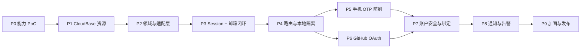

# Commit Web CloudBase 登录注册实施拆分与分阶段路线图

**文档版本**：1.0  
**规划日期**：2026-07-20  
**上游方案**：`docs/cloudbase-authentication-plan.md`  
**阶段性质**：实施任务设计，不包含代码实现或 CloudBase 资源变更

## 1. 目标与边界

本文将上游架构方案拆成能够独立开发、测试和验收的实施阶段。每个阶段都明确：

- 前置依赖；
- CloudBase 资源操作；
- 新增或改造的页面；
- Domain、Application、Data、Presentation 各层文件；
- 云函数和数据库任务；
- 测试范围；
- 阶段退出条件；
- 不满足条件时的停止点。

本路线图实现邮箱、手机号、GitHub 三种登录注册方式，路由保护、手机号绑定、基础安全事件、
验证码防刷和告警。以下内容仍不在本专项内：

- 业务数据云同步；
- 团队、组织和管理员后台；
- 完整 RBAC 管理界面；
- MFA、Passkey 和可信设备；
- 跨设备任务数据合并。

但“本地业务数据按登录用户隔离”必须包含在本专项中。它不是云同步，而是避免同一浏览器中
不同账号看到对方 Dexie 数据的最低安全要求。

## 2. 关键实施决策

### 2.1 页面策略

登录和注册继续使用当前落地页上的 `AuthDialog`，不新增独立的 `/login`、`/signup` 页面。
原因是现有布局已经支持 URL、刷新、浏览器前进后退、焦点恢复和 Landing 持续挂载。

需要新增三个真正独立的页面：

| 路由 | 页面 | 访问级别 | 必要性 |
|---|---|---|---|
| `/auth/callback` | OAuthCallbackScreen | public callback | 处理 GitHub OAuth、错误、state 和安全回跳 |
| `/auth/local-data` | LocalDataOwnershipScreen | authenticated/setup | 处理旧 Dexie 数据归属及跨账号隔离 |
| `/settings/security` | AccountSecurityScreen | authenticated | 管理登录方式、手机号绑定和安全记录 |

不新增以下页面：

- 手机验证码页：作为 Login/Signup Form 内的步骤；
- 邮箱验证码页：作为 Signup Form 内的步骤；
- 忘记密码页：继续作为 `/login` Dialog 内部子视图；
- CAPTCHA 页：作为认证 Dialog 内的挑战区；
- 手机号冲突页：在 AccountSecurityScreen 内使用受控 Dialog；
- Session 失效页：路由守卫直接带 `returnTo` 跳 `/login`。

### 2.2 视觉规格

- 用途：认证页面负责进入工作区和恢复会话，安全页面负责管理真实登录身份；
- 方向：沿用当前 V3 工业化、安静、工作台导向的设计；
- 色彩：只使用 `--v3-*` Token；
- 字体：沿用 IBM Plex Sans 和 JetBrains Mono；
- 布局：登录注册继续使用 Landing + Dialog；账户安全页使用 V3AppShell 下的紧凑设置布局；
- 图标：统一 Lucide，常规 `size={16}`、`strokeWidth={1.5}`；
- 交互：验证码、OAuth、绑定和重新认证都必须有 loading、success、error、rate-limited 状态；
- 响应式：认证 Dialog 在移动端可纵向滚动，OTP 输入、国家区号和发送按钮不得挤压溢出。

项目已经有批准的 V3 Token 和品牌字体，因此它们优先于通用 UI skill 的默认配色和字体建议。

### 2.3 验证码实现路径必须先 PoC

手机号验证码存在两个互斥实现选项，阶段 0 必须确认后只选择一个：

**路径 A：CloudBase Web Auth 原生 OTP**

- 浏览器调用官方 `signInWithOtp`/`signUp`；
- 使用 CloudBase 自带 60 秒目标限制、IP 限制和 CAPTCHA；
- 应用可增加风险预检，但攻击者可能绕过预检直接调用公开 Auth 接口；
- 只有当平台硬限额、供应商预算和控制台策略足够保护成本时才允许上线。

**路径 B：完全受控 OTP + Custom Ticket**

- 浏览器只能请求 Auth Gateway；
- 网关调用短信供应商、维护 OTP 哈希、错误次数和全局预算；
- 验证成功后由可信 Node 后端签发 CloudBase custom login ticket；
- 防刷和成本控制完整，但开发、审计和密钥管理复杂度更高。

选择标准：如果原生 OTP 不能禁止或有效约束浏览器绕过网关，并且短信资源存在明显成本风险，
选择路径 B。不能同时开放两条短信发送路径，否则限流会失效。

### 2.4 CloudBase SDK 合同验证

CloudBase 文档版本之间存在接口差异。实施不能只按示例记忆，阶段 0 必须通过以下信息冻结
真实合同：

- `queryAppAuth` 返回的 `sdkStyle` 与 `sdkHints`；
- 项目最终安装的 `@cloudbase/js-sdk` 类型声明；
- `getSession`、`refreshSession`、OAuth、identity link 和 auth state event 的实际可用性；
- Email/Phone `signUp` 参数；
- GitHub Provider 是通用 OAuth、ID Token 还是 Custom Ticket；
- Session persistence 是否只支持 `local`。

后续代码以 PoC 结果和安装版本类型为准，禁止用 `any` 绕过差异。

## 3. 目标路由结构

```text
/
├── /login                              guestOnly，打开 Login Dialog
├── /signup                             guestOnly，打开 Signup Dialog
├── /auth/callback                      public callback
└── AuthenticatedRoute
    ├── /auth/local-data                已登录但尚未完成本地数据归属
    └── WorkspaceOwnershipGuard
        ├── /workspace
        ├── /repository/:id
        ├── /repository/:id/tasks
        ├── /insights
        ├── /settings
        ├── /settings/security
        └── 所有旧兼容路由
```

守卫执行顺序：

```text
AuthSessionBootstrap
  -> 初始化中：显示 V3 全屏 Loading
  -> 初始化错误：显示重试，不伪装成退出
  -> guest：AuthenticatedRoute 跳 /login?returnTo=...
  -> authenticated：WorkspaceOwnershipGuard 检查本地工作区归属
     -> 未决定：/auth/local-data
     -> 当前 principal 匹配：进入目标页
     -> 属于其他 principal：阻止读取并要求切换账户或创建隔离工作区
```

`/auth/callback` 不放在 `guestOnly` 下。OAuth 回调期间可能已经建立临时 Session，若先执行
PublicOnlyRoute，可能在 callback 完成前被错误重定向。

`/auth/local-data` 只经过 AuthenticatedRoute，不经过 WorkspaceOwnershipGuard。它正是解决
归属未完成或 owner 不匹配的页面，若再次套用归属守卫会产生重定向循环。

## 4. 页面级实现拆分

### 4.1 现有 `/login` Dialog 改造

负责文件：

```text
src/presentation/screens/auth/auth-dialog.tsx
src/presentation/screens/auth/login-form.tsx
src/presentation/screens/auth/auth-types.ts
src/presentation/screens/auth/auth-validation.ts
```

新增组件：

```text
src/presentation/screens/auth/auth-method-control.tsx
src/presentation/screens/auth/email-login-form.tsx
src/presentation/screens/auth/phone-login-form.tsx
src/presentation/screens/auth/otp-field.tsx
src/presentation/screens/auth/phone-field.tsx
src/presentation/screens/auth/captcha-challenge.tsx
src/presentation/screens/auth/auth-route-notice.tsx
```

功能拆分：

1. `AuthMethodControl` 在邮箱和手机号之间切换；
2. EmailLoginForm 提交邮箱和密码；
3. PhoneLoginForm 分“发送验证码”和“验证并登录”两步；
4. OTPField 允许粘贴，支持自动聚焦但不读取短信；
5. 发送成功后根据服务端 `retryAfterSeconds` 倒计时；
6. `CAPTCHA_REQUIRED` 时内联打开 CaptchaChallenge；
7. GitHub 按钮调用 OAuth UseCase，不在组件中直接操作 SDK；
8. `returnTo` 存在时显示目标说明；
9. 统一错误文案，不暴露邮箱/手机号是否存在；
10. 成功后由路由工具执行 `replace(safeReturnTo)`。

完成状态：idle、validating、requestingCode、verifyingCode、signingIn、redirecting、rateLimited、
captchaRequired、error。

### 4.2 现有 `/signup` Dialog 改造

负责文件：

```text
src/presentation/screens/auth/signup-form.tsx
src/presentation/screens/auth/auth-dialog.tsx
src/presentation/screens/auth/auth-validation.ts
```

新增组件：

```text
src/presentation/screens/auth/email-signup-form.tsx
src/presentation/screens/auth/phone-signup-form.tsx
src/presentation/screens/auth/password-strength.tsx
src/presentation/screens/auth/terms-consent.tsx
```

邮箱注册步骤：

```text
填写邮箱和密码
  -> 同意协议
  -> 发送邮箱验证码
  -> 输入验证码
  -> CloudBase 创建账号/验证邮箱
  -> bootstrap principal
  -> 建立 Session
  -> 本地数据归属检查
  -> returnTo 或 /workspace
```

手机注册步骤：

```text
填写国家区号和手机号
  -> 同意协议
  -> 风控/CAPTCHA
  -> 发送短信验证码
  -> 验证 OTP
  -> 创建 CloudBase 身份
  -> bootstrap principal
  -> 本地数据归属检查
```

GitHub 注册与登录共用同一按钮和 callback；区别只在发起时记录 `intent=signup`，用于首次创建
profile 和协议版本。不得根据 GitHub 邮箱自动合并现有邮箱账号。

### 4.3 现有忘记密码视图改造

负责文件：

```text
src/presentation/screens/auth/forgot-password-view.tsx
```

建议拆分：

```text
src/presentation/screens/auth/recovery-request-view.tsx
src/presentation/screens/auth/reset-password-view.tsx
```

要求：

- 请求阶段无论账号是否存在都显示同样成功提示；
- 邮箱链接或 OTP 回到 `/auth/callback`；
- callback 完成恢复凭据校验后进入 ResetPasswordView；
- 新密码成功后递增 `security_version`，撤销其他 Session；
- 写入 PASSWORD_RESET 安全事件和通知 Outbox；
- 恢复 Token 只保存在 SDK/短期内存，不进入 query、Dexie 或日志。

### 4.4 新增 `/auth/callback`

文件：

```text
src/presentation/screens/auth/oauth-callback-screen.tsx
src/presentation/screens/auth/oauth-callback-screen.test.tsx
src/core/auth/oauth-state-storage.ts
src/core/auth/oauth-state-storage.test.ts
```

页面状态：

- processing：显示“正在完成身份验证”；
- cancelled：用户取消 GitHub 授权，可回登录；
- invalidState：state 不匹配或过期，拒绝继续；
- providerError：Provider 返回错误；
- profileBootstrapError：已有 Session 但应用 profile 初始化失败，可重试；
- success：安全 `replace(returnTo)`；
- recovery：转回 AuthDialog 的密码重置子视图。

安全要求：

- 校验 state、发起时间、intent 和一次性 nonce；
- state 记录最多存活 10 分钟，用后即删；
- 只接受安全站内 `returnTo`；
- callback 页面不显示 OAuth code、Token 或完整 Provider 错误；
- callback 失败不能自动循环重新发起 OAuth。

### 4.5 新增 `/auth/local-data`

文件：

```text
src/presentation/screens/auth/local-data-ownership-screen.tsx
src/presentation/screens/auth/local-data-ownership-screen.test.tsx
src/domain/entities/local-workspace-owner.ts
src/domain/repositories/i-local-workspace-repository.ts
src/application/usecases/auth/resolve-local-workspace-usecase.ts
src/data/repositories/dexie-local-workspace-repository.ts
```

页面出现条件：

- 已建立真实 Session；
- 当前浏览器存在旧 `commit-db` 数据但没有 principal 归属；或
- 当前登录 principal 与本地工作区 owner 不匹配。

首次认领流程：

1. 展示本地仓库、任务数量摘要，不展示具体敏感内容；
2. 用户选择“关联到当前账户”或“创建空白本地工作区”；
3. 关联前二次确认；
4. 写入不可变的本地 owner 元数据；
5. 后续仅相同 `principal_id` 可由 UI 打开该命名空间。

账号不匹配流程：

- 不加载仓库、任务详情；
- 提供“切换回原账户”；
- 提供“为当前账户创建独立本地工作区”；
- 不提供一键覆盖原 owner；
- 数据导入/迁移到其他账户属于后续数据迁移专项。

推荐最终数据库命名为 `commit-db-{principalId}`。旧 `commit-db` 只在首次认领流程读取，迁移
成功前保留原库，校验完成后再决定是否清理。该迁移必须具有失败回滚和幂等测试。

### 4.6 新增 `/settings/security`

文件：

```text
src/presentation/screens/settings/account-security-screen.tsx
src/presentation/screens/settings/account-security-screen.test.tsx
src/presentation/screens/settings/security-identity-list.tsx
src/presentation/screens/settings/bind-phone-dialog.tsx
src/presentation/screens/settings/reauth-dialog.tsx
src/presentation/screens/settings/security-event-list.tsx
```

页面区块：

1. 账户摘要：头像、展示名、principal ID 的短格式；
2. 登录方式：邮箱、手机号、GitHub 的掩码和验证状态；
3. 绑定手机号：重新认证 -> 验证码 -> 唯一冲突处理；
4. 密码：修改密码或设置密码；
5. 最近安全活动：新设备登录、改密、绑定、解绑、Session 撤销；
6. 危险操作入口：账号合并和删除账号先只保留受控入口，可分后续阶段启用。

入口改造：

- `v3-user-menu.tsx` 增加“账户与安全”；
- `settings-screen.tsx` 的账户卡显示真实身份，并链接 `/settings/security`；
- `/settings` 继续管理外观、提醒、本地数据和仓库，不把身份管理塞进现有 scope；
- 页面所有身份变更都要求最近 10 分钟内重新认证。

### 4.7 现有应用页改造范围

`TodayWorkspaceScreen`、Repository 页面和 Insights 页面不直接接入 Auth SDK。它们只受到路由
守卫和本地工作区归属守卫保护，避免 Presentation 跨层依赖。

必须改造的共享区域：

- `V3UserMenu`：真实用户摘要、账户安全、退出；
- `V3BottomStatusBar`：可选显示在线/Session 恢复状态，不显示 Token；
- `V3AppShell`：不自行判断登录，只渲染已经通过守卫的内容；
- Settings 账户卡：去掉“本地模式 + 禁用登录”占位；
- Landing 入口：访客去登录，已登录去工作台；落地页只读代码不直接改动时，通过现有可注入
  的 header action/布局边界接入。

## 5. 目标代码结构

```text
src/
├── core/
│   ├── auth/
│   │   ├── auth-return-to.ts
│   │   ├── oauth-state-storage.ts
│   │   └── session-refresh-lock.ts
│   └── cloudbase/
│       ├── cloudbase-client.ts
│       ├── cloudbase-config.ts
│       └── cloudbase-types.ts
├── domain/
│   ├── entities/
│   │   ├── auth-session.ts
│   │   ├── auth-identity.ts
│   │   ├── auth-challenge.ts
│   │   ├── user-profile.ts
│   │   └── local-workspace-owner.ts
│   └── repositories/
│       ├── i-auth-repository.ts
│       ├── i-auth-security-repository.ts
│       └── i-local-workspace-repository.ts
├── application/usecases/auth/
│   ├── initialize-auth-session-usecase.ts
│   ├── sign-in-with-email-usecase.ts
│   ├── sign-up-with-email-usecase.ts
│   ├── request-auth-challenge-usecase.ts
│   ├── verify-phone-auth-usecase.ts
│   ├── start-github-auth-usecase.ts
│   ├── complete-oauth-callback-usecase.ts
│   ├── bootstrap-user-profile-usecase.ts
│   ├── bind-phone-usecase.ts
│   ├── reauthenticate-usecase.ts
│   ├── sign-out-usecase.ts
│   └── resolve-local-workspace-usecase.ts
├── data/repositories/
│   ├── cloudbase-auth-repository.ts
│   ├── cloudbase-auth-security-repository.ts
│   └── dexie-local-workspace-repository.ts
└── presentation/
    ├── routes/
    │   ├── auth-session-bootstrap.tsx
    │   ├── authenticated-route.tsx
    │   ├── public-only-route.tsx
    │   └── workspace-ownership-guard.tsx
    ├── stores/auth-store.ts
    └── screens/
        ├── auth/
        │   ├── oauth-callback-screen.tsx
        │   └── local-data-ownership-screen.tsx
        └── settings/account-security-screen.tsx

cloudfunctions/
├── auth-gateway/
│   ├── index.js
│   ├── scf_bootstrap
│   ├── package.json
│   └── src/
│       ├── router.js
│       ├── auth-context.js
│       ├── challenge-service.js
│       ├── rate-limit-service.js
│       ├── captcha-service.js
│       ├── identity-service.js
│       ├── profile-service.js
│       ├── security-event-service.js
│       └── response.js
├── security-notification-worker/
│   ├── index.js
│   └── package.json
└── auth-risk-evaluator/
    ├── index.js
    └── package.json

cloudbase/migrations/
├── 001_auth_principals.sql
├── 002_auth_identities.sql
├── 003_auth_challenges_and_limits.sql
├── 004_auth_security_events.sql
├── 005_auth_rls.sql
└── 006_auth_seed_and_verification.sql
```

云函数示例路径是后续实现建议。实际创建前必须用 MCP 检查当前项目是否已有函数根目录，避免
覆盖用户已有部署结构。

## 6. 分阶段实施计划

阶段依赖：



### P0：环境、Provider 与 SDK PoC

**目标**：消除所有会改变实现路径的未知项，不写正式 UI。

任务：

- [ ] P0.1 验证 CloudBase MCP 可用并读取工具完整参数；
- [ ] P0.2 解析 canonical EnvId，记录 region、RuntimeMode 和 RuntimeBackends；
- [ ] P0.3 确认 PostgreSQL、Cloud Functions、CLS 是否可用；
- [ ] P0.4 查询 Login Config、Provider 列表、静态域名和 Publishable Key；
- [ ] P0.5 确认 Email sender/SMTP 和 SMS provider 状态；
- [ ] P0.6 用测试账号验证 Email signUp、verify、signIn、recovery；
- [ ] P0.7 验证 Phone OTP 的发送、CAPTCHA、错误次数和平台硬限额；
- [ ] P0.8 验证 GitHub Provider 配置、回调 URI 和 SDK 调用路径；
- [ ] P0.9 验证 getSession、refreshSession、identity link 和 auth state event；
- [ ] P0.10 决定 OTP 路径 A 或 B，并形成 ADR；
- [ ] P0.11 核实短信套餐、费用预算告警和通知渠道；
- [ ] P0.12 输出 `docs/cloudbase-authentication-poc-results.md`。

PoC 产物必须记录成功请求的脱敏输入输出形状、SDK 版本和 MCP 返回的 `sdkHints`，不能记录
Secret、Token、OTP 或完整手机号。

**退出条件**：

- GitHub、Email、Phone 各有唯一实现路径；
- 确定 PG 环境可用；
- 确定 OTP 无法绕过的成本保护方案；
- 确定 Session API 合同；
- P0 结果经过人工确认后才能执行资源写操作。

**停止条件**：

- 没有真实 Publishable Key；
- GitHub 回调能力不明确；
- Phone OTP 可无限绕过且没有供应商预算熔断；
- 当前环境不支持 PG 且未决定新环境方案。

### P1：CloudBase 资源准备

**前置**：P0 通过。  
**目标**：所有前端依赖的 Provider、表、权限、函数和日志先存在。

任务：

- [ ] P1.1 通过 `manageAppAuth` 启用确认后的 Email/Phone 登录方式；
- [ ] P1.2 配置 Email sender、SMS 模板和安全域名；
- [ ] P1.3 创建/更新 GitHub Provider，配置测试和生产回调白名单；
- [ ] P1.4 创建 migrations 目录和 001-006 迁移文件；
- [ ] P1.5 通过 `managePgDatabase(planMigration)` 预览迁移；
- [ ] P1.6 创建 principals、auth_subjects、user_identities；
- [ ] P1.7 创建 challenges、rate_limits、merge_requests；
- [ ] P1.8 创建 security_events 和 notification_outbox；
- [ ] P1.9 添加唯一索引、外键、CHECK、updated_at 机制；
- [ ] P1.10 配置 GRANT 和 RLS，并验证 `auth.uid()`；
- [ ] P1.11 创建 Auth Gateway HTTP Function 骨架和安全规则；
- [ ] P1.12 创建通知 Worker、风险评估定时函数骨架；
- [ ] P1.13 启用 CLS，确定结构化日志字段；
- [ ] P1.14 配置函数 Secret 和环境变量；
- [ ] P1.15 用 anon、authenticated、service_role 三种身份验证权限。

Auth Gateway 使用 HTTP Function，因为它提供浏览器调用的 REST 接口；必须监听 9000、处理
OPTIONS、限制允许来源、限制方法并返回统一 JSON。通知 Worker 和风险评估器使用 Event
Function/定时触发。

建议 Secret/配置名：

```text
TCB_ENV_ID
AUTH_HMAC_PEPPER
AUTH_ALLOWED_ORIGINS
AUTH_SMS_DAILY_BUDGET
AUTH_RATE_LIMIT_PROFILE
GITHUB_CLIENT_ID
GITHUB_CLIENT_SECRET（仅自管 OAuth 路径）
SECURITY_NOTIFICATION_SENDER
```

**测试**：迁移可重复、唯一索引冲突、RLS 跨用户拒绝、函数 CORS、未认证端点白名单、Secret
不出现在返回值和日志。

**退出条件**：前端即将调用的每项资源均已在测试环境真实验证，不允许用 Mock 资源进入 P2。

### P2：Domain、Application、Data 基础层

**前置**：P1 通过。  
**目标**：先建立类型安全边界，不改页面行为。

任务：

- [ ] P2.1 安装并锁定已验证版本的 `@cloudbase/js-sdk`；
- [ ] P2.2 新增 CloudBase config 类型和环境变量校验；
- [ ] P2.3 新增单例 client，不在组件内重复 init；
- [ ] P2.4 建立 AuthSession、AuthIdentity、UserProfile、AuthChallenge 实体；
- [ ] P2.5 定义 IAuthRepository；
- [ ] P2.6 定义 IAuthSecurityRepository；
- [ ] P2.7 定义 ILocalWorkspaceRepository；
- [ ] P2.8 实现 CloudBaseAuthRepository；
- [ ] P2.9 实现 CloudBaseAuthSecurityRepository；
- [ ] P2.10 实现错误码映射和 `unknown` 收窄；
- [ ] P2.11 新增 auth UseCase，每个 UseCase 保持单一职责；
- [ ] P2.12 在 tsyringe 注册接口和 UseCase；
- [ ] P2.13 为 Repository 和 UseCase 编写单元测试；
- [ ] P2.14 增加 config 缺失时的显式启动错误。

接口边界建议：

```text
IAuthRepository
  getSession
  refreshSession
  signInWithEmail
  signUpWithEmail
  startPhoneAuth
  verifyPhoneAuth
  startGithubAuth
  completeOAuthCallback
  reauthenticate
  linkIdentity
  unlinkIdentity
  signOut

IAuthSecurityRepository
  requestChallenge
  bootstrapProfile
  getCurrentProfile
  bindPhone
  listSecurityEvents
  createMergeRequest
```

Repository 方法可按 P0 SDK 合同调整，但 Presentation 不得直接依赖 CloudBase SDK 类型。

**退出条件**：类型检查、Repository 测试和 UseCase 测试通过；页面仍使用 demo store，现有行为
不回归。

### P3：Session 初始化与邮箱认证纵向闭环

**前置**：P2 通过。  
**目标**：先用邮箱完成一个可上线质量的登录注册闭环。

任务：

- [ ] P3.1 新增 `useAuthStore` 四态模型；
- [ ] P3.2 实现 initialize、refresh、signOut 和 profile bootstrap；
- [ ] P3.3 新增 AuthSessionBootstrap；
- [ ] P3.4 订阅/适配已验证的 auth state 事件；若版本不支持则用明确替代机制；
- [ ] P3.5 实现 session refresh 单飞锁；
- [ ] P3.6 改造 EmailLoginForm；
- [ ] P3.7 改造 EmailSignupForm 和邮箱验证码步骤；
- [ ] P3.8 改造 RecoveryRequest/ResetPassword；
- [ ] P3.9 接入 AuthDialog，但暂不开放 Phone/GitHub 按钮；
- [ ] P3.10 登录成功后调用 bootstrapProfile；
- [ ] P3.11 统一认证错误和防枚举文案；
- [ ] P3.12 添加 Session、刷新、邮箱注册登录、恢复测试；
- [ ] P3.13 浏览器验证刷新后恢复 Session；
- [ ] P3.14 确认 Token 不进入 Zustand 持久化、Dexie 和日志。

迁移 demo store 的策略：

- 开发分支中先让 AuthDialog 通过依赖注入消费新 Store；
- Email 闭环验证完成后一次性删除运行时 `admin/admin` 和模拟 GitHub；
- 测试使用 FakeAuthRepository，不保留任何生产后门或 Vite 绕过开关；
- 删除前必须更新所有引用 `useDemoAuthStore` 的测试。

**退出条件**：真实邮箱注册、登录、刷新、退出和找回全部通过；演示凭据在运行时代码中消失。

### P4：路由保护与本地工作区归属隔离

**前置**：P3 通过。  
**目标**：未登录无法进入应用，同时避免不同账号共享同一 Dexie 数据。

任务：

- [ ] P4.1 实现严格 `sanitizeReturnTo`；
- [ ] P4.2 新增 PublicOnlyRoute；
- [ ] P4.3 新增 AuthenticatedRoute；
- [ ] P4.4 把所有 V3 应用页和旧兼容路由放入守卫；
- [ ] P4.5 初始化错误显示重试而非跳登录；
- [ ] P4.6 实现 WorkspaceOwnershipGuard；
- [ ] P4.7 设计 principal 级 Dexie 命名空间；
- [ ] P4.8 实现旧 `commit-db` 摘要、认领、复制校验和幂等迁移；
- [ ] P4.9 新增 LocalDataOwnershipScreen；
- [ ] P4.10 退出只关闭访问，不删除本地数据；
- [ ] P4.11 不同 principal 登录时不加载其他命名空间；
- [ ] P4.12 覆盖所有深链、query、hash 和恶意 returnTo 测试；
- [ ] P4.13 验证用户 A 退出、用户 B 登录的数据隔离。

必须保护：`/workspace`、全部 `/repository/*`、`/insights`、`/settings`、
`/settings/security` 和旧 compatibility routes。

**退出条件**：访客和错误账号无法通过 UI、路由或 Store 加载受保护业务数据；旧本地数据迁移
失败时原库仍完整。

### P5：手机号 OTP、CAPTCHA 与成本熔断

**前置**：P4 通过，P0 已选择 OTP 路径。  
**目标**：实现不能被前端绕过的手机号注册登录和资源保护。

资源先行任务：

- [ ] P5.1 完成 OTP 路径对应的 Auth Gateway 后端；
- [ ] P5.2 实现 target/IP/device/principal/global 原子限流；
- [ ] P5.3 实现 60 秒冷却、小时/日额度和 5 次验证失败作废；
- [ ] P5.4 实现 CAPTCHA_REQUIRED 协议；
- [ ] P5.5 实现日预算 70/85/95/100% 阶梯；
- [ ] P5.6 实现幂等 key，避免双击/重试重复发送；
- [ ] P5.7 写入 SEND_CODE、VERIFY_CODE 和 RATE_LIMIT 安全事件；
- [ ] P5.8 在真实环境验证绕过 UI 仍受限制。

前端任务：

- [ ] P5.9 新增 PhoneField、OtpField、CaptchaChallenge；
- [ ] P5.10 实现 PhoneLoginForm；
- [ ] P5.11 实现 PhoneSignupForm；
- [ ] P5.12 倒计时完全使用服务端 retryAfter；
- [ ] P5.13 登录页禁止自动注册，注册页允许创建；
- [ ] P5.14 处理短信预算耗尽的可恢复提示；
- [ ] P5.15 添加手机号 E.164 和国家区号测试；
- [ ] P5.16 用并发请求验证原子额度。

**退出条件**：直接调用接口、刷新页面、切换表单或并发请求都不能绕过额度；短信达到全局预算
后停止发送但邮箱/GitHub 仍可用。

### P6：GitHub OAuth

**前置**：P4 通过，GitHub Provider 已在目标环境配置。  
**目标**：完成 GitHub 首次注册、再次登录、取消和错误恢复。

任务：

- [ ] P6.1 实现 OAuth state storage 和 10 分钟 TTL；
- [ ] P6.2 实现 StartGithubAuthUseCase；
- [ ] P6.3 新增 `/auth/callback` 路由和页面；
- [ ] P6.4 实现 callback state/nonce/intent/returnTo 校验；
- [ ] P6.5 实现 Provider error 和用户取消状态；
- [ ] P6.6 callback 后幂等 bootstrap profile；
- [ ] P6.7 使用 GitHub immutable subject 建立 identity；
- [ ] P6.8 禁止按 GitHub 邮箱自动合并；
- [ ] P6.9 登录和注册 Dialog 接入同一 GitHub 按钮；
- [ ] P6.10 添加重放、过期 state、开放重定向和取消授权测试；
- [ ] P6.11 浏览器验证 callback 刷新不会重复创建 principal。

**退出条件**：OAuth code/Token 不落日志，state 重放失败，callback 只能跳安全站内目标。

### P7：账户安全页、手机号绑定与冲突

**前置**：P5、P6 通过。  
**目标**：让邮箱和 GitHub 用户安全绑定手机号，并处理唯一冲突。

资源先行任务：

- [ ] P7.1 实现 reauthentication ticket/时间窗；
- [ ] P7.2 实现 bind_phone challenge purpose；
- [ ] P7.3 实现手机号条件唯一索引和事务绑定；
- [ ] P7.4 实现幂等绑定；
- [ ] P7.5 实现 PHONE_ALREADY_BOUND 脱敏错误；
- [ ] P7.6 写入 IDENTITY_BOUND/CONFLICT 事件和通知 Outbox；
- [ ] P7.7 实现至少保留一种可登录身份的解绑规则。

页面任务：

- [ ] P7.8 新增 AccountSecurityScreen；
- [ ] P7.9 新增 SecurityIdentityList；
- [ ] P7.10 新增 ReauthDialog；
- [ ] P7.11 新增 BindPhoneDialog；
- [ ] P7.12 新增 SecurityEventList；
- [ ] P7.13 V3UserMenu 增加账户安全入口；
- [ ] P7.14 Settings 账户卡链接真实页面；
- [ ] P7.15 绑定成功刷新 Session/User/Profile；
- [ ] P7.16 冲突时提供“登录原账号处理”而非覆盖；
- [ ] P7.17 覆盖双并发绑定和账号枚举测试。

账号合并的完整数据迁移可推迟，但本阶段至少要建立 merge request 状态机和双账号证明接口，
确保手机号冲突有安全的后续路径。

**退出条件**：仅当前账号 OTP 不能夺取已绑定手机号；所有敏感操作需要重新认证。

### P8：用户安全通知、持续告警与巡检

**前置**：P7 通过。  
**目标**：风险发生时能通知用户和运营，而不是只在数据库留记录。

任务：

- [ ] P8.1 完成 SecurityNotificationOutbox 写入；
- [ ] P8.2 实现 Worker 抢占、重试、退避和死信；
- [ ] P8.3 实现新设备、改密、绑定、解绑、合并通知模板；
- [ ] P8.4 通知内容只使用掩码和粗粒度地区；
- [ ] P8.5 实现风险评估定时函数；
- [ ] P8.6 配置短信日预算和 OTP 失败率告警；
- [ ] P8.7 配置 Auth Gateway 5xx、延迟和调用量告警；
- [ ] P8.8 配置 Outbox 积压和 Worker 失败告警；
- [ ] P8.9 配置 Critical/Warning 接收人；
- [ ] P8.10 建立每日指标检查和每周 ops-inspector 巡检；
- [ ] P8.11 验证 CLS 结构化日志不含 PII/Token/OTP；
- [ ] P8.12 人工触发测试告警并确认接收链路。

**退出条件**：至少一个用户安全通知和每个 Critical 运维告警在测试环境完成端到端验证。

### P9：安全加固、灰度和正式发布

**前置**：P8 通过。  
**目标**：删除临时路径，完成全量验证并灰度上线。

任务：

- [ ] P9.1 全仓搜索并删除 demo auth、admin/admin 和模拟 GitHub；
- [ ] P9.2 扫描浏览器 bundle，确认无 API Key、Client Secret、pepper；
- [ ] P9.3 完成 CSP、安全域名、CORS、OAuth 回调白名单；
- [ ] P9.4 完成用户枚举、开放重定向、XSS、CSRF/state、OTP 重放测试；
- [ ] P9.5 完成 A/B principal 本地数据隔离测试；
- [ ] P9.6 完成邮箱、手机、GitHub 全流程 Playwright E2E；
- [ ] P9.7 完成移动端和桌面端视觉检查；
- [ ] P9.8 运行 lint、tsc、test、build 全量门禁；
- [ ] P9.9 运行 cloudbase-code-review 并修复全部 error；
- [ ] P9.10 运行 ops-inspector 获取发布前健康基线；
- [ ] P9.11 先开放内部账户，再开放邮箱，再小比例开放短信注册；
- [ ] P9.12 观察 24 小时错误率、限流率、短信预算和通知积压；
- [ ] P9.13 全量后保留回滚部署，不保留认证绕过开关。

**退出条件**：上线阻断项全部关闭，质量门禁全绿，真实浏览器三种认证均通过，运维接收人已
确认告警链路。

## 7. 数据库迁移细化

### 7.1 001_auth_principals.sql

- 创建 `principals`；
- 创建 status CHECK；
- 创建 merged_into_id 自引用 FK；
- 创建 security_version；
- 创建 updated_at trigger/function；
- 不授予 anon 访问。

### 7.2 002_auth_identities.sql

- 创建 `auth_subjects` 和 `user_identities`；
- `(provider, provider_subject)` 唯一；
- active phone `identifier_hash` 条件唯一；
- active email 唯一策略按 P0 业务决策落地；
- 同一 principal 仅一个 active canonical auth subject；
- 创建 principal/provider 索引。

### 7.3 003_auth_challenges_and_limits.sql

- 创建 `verification_challenges`；
- 创建 `auth_rate_limits`；
- 创建 `account_merge_requests`；
- challenge 状态与 purpose CHECK；
- 原子 consume quota 数据库函数；
- 过期 challenge 清理函数；
- 只授予 service_role。

若选择完全受控 OTP，追加 OTP hash、salt/version 字段，但绝不保存明文。若选择 CloudBase 原生
OTP，只保存 provider verification ID 和应用风控状态。

### 7.4 004_auth_security_events.sql

- 创建 `auth_security_events`；
- 创建 `security_notification_outbox`；
- event_type/risk_level/created_at 索引；
- Outbox `(event_id, channel)` 唯一；
- metadata JSON schema 在应用层验证；
- 创建按时间归档/清理策略。

### 7.5 005_auth_rls.sql

- authenticated 只能读自己的 principal 摘要；
- authenticated 只能读自己的 identity 掩码；
- authenticated 只能读允许公开给自己的 security events；
- 浏览器不能 insert/update/delete 身份和安全表；
- service_role 用于可信后端并绕过 RLS；
- 使用 `auth.uid()`，禁止 `current_user` 作为最终用户标识。

### 7.6 006_auth_seed_and_verification.sql

- 不创建默认 admin 用户；
- 只插入枚举配置或系统版本记录；
- 执行 schema/索引/策略自检查询；
- 用测试用户 A/B 验证跨用户拒绝；
- 记录迁移版本和校验结果。

## 8. Auth Gateway 路由拆分

| 方法 | 路径 | 认证 | 所属阶段 | 处理器 |
|---|---|---|---|---|
| POST | `/v1/auth/challenges` | public + risk | P5 | challenge-service |
| POST | `/v1/auth/challenges/:id/verify` | public + risk | P5 | challenge-service |
| POST | `/v1/auth/profile/bootstrap` | session | P3 | profile-service |
| GET | `/v1/auth/me` | session | P3 | profile-service |
| POST | `/v1/auth/reauth` | session | P7 | identity-service |
| POST | `/v1/auth/identities/phone` | session + reauth | P7 | identity-service |
| DELETE | `/v1/auth/identities/:id` | session + reauth | P7 | identity-service |
| GET | `/v1/auth/security-events` | session | P7 | security-event-service |
| POST | `/v1/auth/merge-requests` | dual proof | P7 | identity-service |

公共端点仅限验证码和必要的 OAuth bootstrap。所有其他路由必须从 CloudBase 调用上下文或经过
验证的 Bearer Session 获取 `uid`，不能信任 body 中的 userId/principalId。

统一处理顺序：

```text
CORS/Method
  -> requestId
  -> body size/content-type
  -> caller identity（按路由）
  -> schema validation
  -> idempotency
  -> rate limit/risk/CAPTCHA
  -> transaction/business logic
  -> security event
  -> normalized response
```

## 9. 测试文件拆分

### 9.1 Core/Domain/Application

```text
src/core/auth/auth-return-to.test.ts
src/core/auth/oauth-state-storage.test.ts
src/core/auth/session-refresh-lock.test.ts
src/domain/entities/auth-entities.test.ts
src/application/usecases/auth/auth-usecases.test.ts
```

重点：恶意 returnTo、OAuth state 重放、并发刷新、匿名 Session、错误收窄、UseCase 调用次数。

### 9.2 Data

```text
src/data/repositories/cloudbase-auth-repository.test.ts
src/data/repositories/cloudbase-auth-security-repository.test.ts
src/data/repositories/dexie-local-workspace-repository.test.ts
```

CloudBase SDK 使用精确 typed fake；不能让单元测试依赖真实短信。PG 和函数另做测试环境集成测试。

### 9.3 Presentation

```text
src/presentation/routes/authenticated-route.test.tsx
src/presentation/routes/public-only-route.test.tsx
src/presentation/routes/workspace-ownership-guard.test.tsx
src/presentation/stores/auth-store.test.ts
src/presentation/screens/auth/oauth-callback-screen.test.tsx
src/presentation/screens/auth/local-data-ownership-screen.test.tsx
src/presentation/screens/settings/account-security-screen.test.tsx
```

现有 `auth-dialog.test.tsx`、`landing-auth-layout.test.tsx`、`v3-user-menu.test.tsx` 和
`v3-app-shell.test.tsx` 必须从 demo store 改为新 Auth Store/Fake Repository。

### 9.4 云端集成测试

- migration plan/apply/rollback 测试；
- A/B 用户 RLS；
- 验证码并发与预算；
- CAPTCHA；
- GitHub callback；
- identity 唯一冲突；
- Outbox 重试；
- 日志脱敏；
- 告警人工触发。

### 9.5 浏览器 E2E

```text
访客深链 -> 登录 -> 原路径
邮箱注册 -> 验证 -> local-data -> workspace
邮箱退出 -> 刷新 -> 登录页
手机注册/登录 -> 限流/CAPTCHA
GitHub 首次授权 -> callback -> workspace
GitHub 取消 -> callback error -> 登录
邮箱用户 -> security -> 绑定手机号
手机号冲突 -> 不泄露对方信息
用户 A 退出 -> 用户 B 登录 -> 不可见 A 的 Dexie 数据
跨标签页退出 -> 另一个标签页转登录
```

## 10. 阶段门禁与交付物

| 阶段 | 主要交付物 | 必须评审人 | 门禁 |
|---|---|---|---|
| P0 | PoC 结果、OTP/GitHub ADR | 技术负责人、产品 | 实现路径唯一 |
| P1 | Auth 配置、PG、函数、CLS | 后端/运维 | 资源真实可用 |
| P2 | 接口、UseCase、Repository | 架构评审 | 类型与单测通过 |
| P3 | 邮箱闭环、真实 Session | 前端/安全 | 无 demo 后门 |
| P4 | 路由保护、本地隔离 | 前端/数据负责人 | A/B 数据不串 |
| P5 | 手机 OTP、防刷、预算 | 安全/运维 | 不能绕过额度 |
| P6 | GitHub OAuth callback | 安全/前端 | state/回跳安全 |
| P7 | 账户安全、绑定冲突 | 产品/安全 | 不可夺号 |
| P8 | 用户通知、运维告警 | 运维/客服 | 告警真实送达 |
| P9 | 全量测试和灰度 | 发布负责人 | 阻断项全关 |

每个阶段完成后更新本文件任务状态并附验证证据。不要在最后一次性把全部任务勾选完成。

## 11. 每阶段统一完成定义

每个编码阶段都必须满足：

```bash
npm run lint
npx tsc -b
npm test
npm run build
```

并满足：

- 新业务逻辑先写或同步写测试；
- 新页面至少一个行为测试；
- 没有 `any`、`@ts-ignore`、空 catch 或禁用测试；
- 真实路由/表单改动使用浏览器验证；
- CloudBase 代码阶段运行 `cloudbase-code-review`；
- 资源变更使用 MCP，前端代码晚于资源准备；
- 生产 Secret 不进入仓库和 Vite 客户端变量；
- 文档同步记录 EnvId 的配置方式，但不提交真实凭据。

## 12. 发布与回滚策略

### 12.1 环境

- 开发：Fake Repository 仅用于单元测试，运行时连接开发 CloudBase 环境；
- 测试：真实 Email/Phone/GitHub 沙箱和 PG/RLS；
- 生产：独立 EnvId、独立 OAuth Client、独立短信预算与告警；
- 不允许用生产短信资源跑自动化压力测试。

### 12.2 灰度顺序

1. 内部测试账号；
2. 邮箱登录注册；
3. GitHub 登录；
4. 手机号登录小比例开放；
5. 手机号注册全量；
6. 手机号绑定与冲突合并入口。

### 12.3 回滚

- 使用上一版前端和函数部署包回滚；
- 数据库迁移使用已预演的 rollback migration，不做破坏性 reset；
- 回滚时可以暂停新注册，但不能恢复 demo admin 后门；
- 已创建的 CloudBase 用户和 principal 不删除；
- 短信异常时熔断 Phone，保留 Email/GitHub；
- OAuth 异常时关闭 GitHub Provider 入口，保留其他方式；
- 任何降级都必须保持应用页面需要真实 Session。

## 13. 实施前必须确认的问题

以下问题已经进入 P0，不需要现在凭经验猜测：

1. 目标 CloudBase canonical EnvId、region 和 PG 模式是什么？
2. Email 使用密码 + 验证码，还是 OTP-only？本路线图默认密码 + 已验证邮箱。
3. 原生 Phone OTP 能否满足不可绕过的成本保护？
4. GitHub 是否支持通用 OAuth Provider，还是需要 ID Token/Custom Ticket？
5. 当前 SDK 是否提供稳定的 auth state event？
6. “记住我”能否映射不同 persistence？若不能，应移除该控件。
7. 短信日预算和 Critical 阈值的正式金额/条数是多少？
8. 安全通知由哪个已验证发件域名发送？
9. 旧 `commit-db` 首次认领是否允许复制为 principal 命名空间？
10. 账号合并在首版启用，还是只提供冲突申诉入口？

这些答案会影响代码合同或用户数据，不应在实现中静默假定。

## 14. 推荐的首个可交付切片

第一批实现不要同时做三种登录。推荐按以下最小闭环推进：

```text
P0 全部完成
  -> P1 基础 Auth/PG/CLS
  -> P2 类型和 Repository
  -> P3 邮箱注册登录
  -> P4 路由保护 + 本地数据隔离
```

这个切片交付后，系统已经具备真实用户、受保护页面、安全回跳和不串本地数据的基本闭环。
Phone、GitHub、绑定和告警在稳定基础上分别增加，出现问题时更容易定位责任层。
